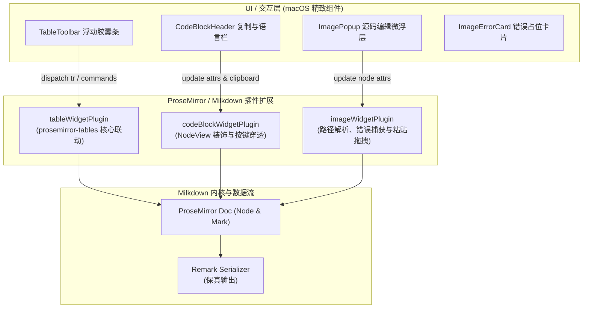

# spec-v0.2.0-m2: 交互式表格、代码块增强与多源图片系统

## 1. 里程碑目标与覆盖 F/AC

### 1.1 里程碑目标
在 M1 完成的 Milkdown 所见即所得骨架与双模式切换基础上，本里程碑实现三大块级核心富交互组件（TableWidget、CodeBlockWidget、ImageWidget），彻底攻克 v0.1.0 在长文写作中排版粗糙、表格无法交互、代码无法便捷复制、图片路径受限的痛点。全面对齐 Typora 原生级体验：
1. **交互式表格 (TableWidget)**：光标进入表格时浮现 macOS 胶囊工具栏，支持增删行列、调整列对齐；Tab 顺畅遍历单元格并在最后一行按 Tab 自动增行；
2. **代码块增强 (CodeBlockWidget)**：围栏代码块右上角浮动 Header，带语言切换与一键「复制代码」能力；键盘上下箭头边界离开逻辑；
3. **多源图片增强 (ImageWidget)**：支持相对路径、绝对路径与网络图片；排版中直观呈现；点击微露出 `` 源码编辑浮层；加载失败优雅降级为占位卡片；集成复制截图自动落盘（./assets/）。

### 1.2 覆盖的 F / AC 清单
- **F11: 交互式表格 (TableWidget)**
  - `AC-11.1`: 打开含 GFM 表格文档渲染为标准 `<table>`，表头加粗，对齐样式（居左/居中/居右）与 Markdown `:---:` 语法完全对应。
  - `AC-11.2`: 在单元格中输入文本，切到源码模式可见对应单元格内容同步更新，且 Markdown 表格语法合法。
  - `AC-11.3`: 按 `Tab` 顺序遍历全部单元格；最后一格按 `Tab` 表格行数 +1 并聚焦新行第一格；`Shift+Tab` 逆向遍历。
  - `AC-11.4`: 浮动工具栏支持：上方增行、下方增行、左侧增列、右侧增列、删除当前行、删除当前列、删除整个表格、设置对齐方式。
- **F12: 高级代码块 (CodeBlockWidget)**
  - `AC-12.1`: 代码块渲染等宽字体（SF Mono），关键字正确区分样式。
  - `AC-12.2`: 右上角 Header 显示语言 tag，修改语言为 `python` 后源码模式同步变为 ```` ```python ````。
  - `AC-12.3`: 点击「复制代码」按钮将纯代码内容（不含首尾围栏符号）写入系统剪贴板，按钮即时变为「已复制 ✓」（2秒后恢复）。
  - `AC-12.4`: 末行按 `↓` 光标进入代码块后方段落（若后方无内容自动新建空段落）；首行按 `↑` 向上离开。
- **F13: 多源图片与交互 (ImageWidget)**
  - `AC-13.1`: 相对路径（`./assets/x.png`，相对文档路径解析）、本地绝对路径（`file:///`）、网络图片均能正常解析与显示。
  - `AC-13.2`: 路径无效或资源不存在时，显示精致占位卡片（文件名 + 「图片无法加载」），控制台 0 未捕获异常。
  - `AC-13.3`: 光标聚焦或鼠标悬浮在图片边缘时，轻微浮出 `` 编辑条，用户可直接修改路径与 Alt 并即时刷新。
  - `AC-13.4`: 继承 F4：剪贴板截图粘贴或系统文件拖拽入编辑器，自动保存至 `./assets/` 并插入相对路径 Markdown 语法。

---

## 2. 总体架构与数据流

### 2.1 架构设计


### 2.2 核心模块拆分

#### 1. Table 交互体系 (`src/renderer/editor/wysiwyg/table/`)
- `TableToolbar.tsx`: 浮动在当前聚焦表格上方的微气泡工具栏，包含增删行列、列对齐方式、整表删除操作。
- `tableKeymap.ts`: 绑定 `Tab`、`Shift+Tab` 单元格遍历以及末尾自动加行命令。
- `tableToolbarPlugin.ts`: ProseMirror 插件，跟踪当前选区是否在 `table` 节点内，计算表格在编辑器视口内的绝对边界并更新浮动工具栏坐标。

#### 2. CodeBlock 交互体系 (`src/renderer/editor/wysiwyg/code/`)
- `CodeBlockView.ts`: 基于 ProseMirror `NodeView` 封装的围栏代码块渲染器。
- `CodeBlockHeader.tsx`: 悬浮于代码块右上角的控制条，包含当前语言选择下拉菜单与带有复制动画反馈的「复制代码」按钮。
- `codeBlockKeymap.ts`: 处理代码块首行 `↑`、末行 `↓` 穿透退出到正文段落。

#### 3. Image 交互体系 (`src/renderer/editor/wysiwyg/image/`)
- `ImageView.ts`: 自定义图片 `NodeView`。
  - 自动根据当前文档的 `filePath` 解析 `./assets/` 相对路径；
  - 监听 `img.onerror`，在失败时渲染轻量占位卡片；
  - 悬浮/点击时弹出 `ImagePopup` 允许修改 `src` 和 `alt`。
- `imagePastePlugin.ts`: 监听 `paste` 与 `drop` 事件，调用 Electron API `saveImageBuffer` 落盘到 `./assets/` 并生成 ``。

---

## 3. 详细接口设计

### 3.1 表格操作接口定义
```typescript
export interface TableToolbarState {
  visible: boolean;
  tablePos: number;
  rect: {
    top: number;
    left: number;
    width: number;
  };
}

export type TableAlign = 'left' | 'center' | 'right';
```

### 3.2 代码块接口定义
```typescript
export interface CodeBlockProps {
  language: string;
  code: string;
  onLanguageChange: (newLang: string) => void;
  onCopy: () => void;
}
```

### 3.3 图片节点属性与路径解析
```typescript
export interface ImageNodeAttrs {
  src: string;
  alt?: string;
  title?: string;
}

export function resolveImageSource(rawSrc: string, docFilePath: string | null): string {
  if (!rawSrc) return '';
  if (rawSrc.startsWith('http://') || rawSrc.startsWith('https://') || rawSrc.startsWith('data:')) {
    return rawSrc;
  }
  if (rawSrc.startsWith('file://')) {
    return rawSrc;
  }
  // 本地绝对路径
  if (rawSrc.startsWith('/')) {
    return `file://${rawSrc}`;
  }
  // 相对路径解析 (基于当前正在编辑的 Markdown 文件所在目录)
  if (docFilePath) {
    const docDir = docFilePath.substring(0, docFilePath.lastIndexOf('/'));
    const cleanRelative = rawSrc.startsWith('./') ? rawSrc.slice(2) : rawSrc;
    return `file://${docDir}/${cleanRelative}`;
  }
  return rawSrc;
}
```

---

## 4. 关键交互流程与边界处理

### 4.1 表格最后一行按 Tab 自动增行
1. 用户在表格任意单元格按 `Tab`；
2. 插件调用 `findTable(selection.$from)` 获取表格节点和映射 `TableMap.get(table.node)`；
3. 判断当前光标是否处于表格最后一行最后一格；
4. 若不是：执行标准 `goToNextCell(1)` 跳转到下一格；
5. 若是：调用 `addRowAfter` 在末尾插入新行，并将选区立即移入新行第 1 个单元格。

### 4.2 代码块按键离开边界穿透
1. 首行按 `↑`：检查当前光标位置是否在代码块内容的首行（`offset === 0` 或首行无向上换行空间）。若为首行，将选区移动到代码块前方的块节点；若前方不存在节点，在前方插入一个段落；
2. 末行按 `↓`：检查当前光标是否在代码块末行。若为末行，将选区移动到代码块后方块节点；若代码块为文档最后节点，在末尾自动追加段落并将光标置于段落首。

### 4.3 相对图片实时加载与错误兜底
1. 当文档具有本地路径（如 `/path/to/doc.md`）且图片路径为 `./assets/cover.png` 时，`resolveImageSource` 输出 `file:///path/to/assets/cover.png`；
2. `ImageView` 监听原生 `img` 的 `error` 事件。若资源不存在，隐藏 `img` 实体并渲染 `ImageErrorCard`，包含「图片加载失败: ./assets/cover.png」提示与点击修改按钮，阻止破坏整篇文档的排版流。

---

## 5. 测试规划 (TDD & E2E)

### 5.1 单元测试套件
1. `tests/unit/table-widget.test.ts`
   - [UT-11.1]: 打开 GFM 表格，节点树与 DOM 正确包含 `table`、`th`、`td` 与对应对齐属性；
   - [UT-11.2]: 执行表格增删行、增删列、设置对齐方式 command，DOM 与 Markdown 序列化正确同步；
   - [UT-11.3]: 在表格末尾按 Tab 触发自动增行。
2. `tests/unit/code-block-widget.test.ts`
   - [UT-12.1]: 围栏代码块渲染带有右上角 Header，包含语言与复制按钮；
   - [UT-12.2]: 点击复制按钮正确提取纯文本代码并调用剪贴板 API；
   - [UT-12.3]: 代码块首行按 `↑`、末行按 `↓` 穿透退出到段落。
3. `tests/unit/image-widget-enhanced.test.ts`
   - [UT-13.1]: 相对路径与绝对路径解析函数 `resolveImageSource` 单测；
   - [UT-13.2]: 图片加载失败时渲染优雅错误占位卡片；
   - [UT-13.3]: 剪贴板图片粘贴事件触发 Electron 文件落盘并插入相对路径 Markdown。

### 5.2 端到端测试 (Playwright E2E)
- `tests/e2e/v0.2.0-m2-rich-blocks.spec.ts`
  - [E2E-2.1]: 在 WYSIWYG 模式点击表格单元格，出现浮动工具栏，点击增行并在最后一格按 Tab 自动增行；
  - [E2E-2.2]: 点击代码块复制按钮，按钮即时变为「已复制 ✓」，剪贴板包含代码文本；
  - [E2E-2.3]: 验证包含相对路径图片的真实汇报稿（如数据共享平台文档）图片正常加载渲染；
  - [E2E-2.4]: 引入不存在的图片路径，验证显示精致占位卡片而不破坏布局。

---

## 6. Task 拆分 (Task Breakdown)

| 编号 | 内容 | 覆盖 AC | 依赖 | 状态 |
|---|---|---|---|---|
| **T211** | 研发交互式表格工具栏组件 `TableToolbar.tsx` 与 ProseMirror 浮动定位插件 | AC-11.1, AC-11.4 | M1 | 已完成 |
| **T212** | 实现表格键盘导航增强：`Tab`/`Shift+Tab` 遍历与末行 Tab 自动增行逻辑 | AC-11.2, AC-11.3 | T211 | 已完成 |
| **T213** | 封装代码块自定义 NodeView `CodeBlockView`，实现右上角语言标签与一键复制代码功能 | AC-12.1, AC-12.2, AC-12.3 | M1 | 已完成 |
| **T214** | 实现代码块键盘边界穿透逻辑（首行 `↑`、末行 `↓` 无缝跳出） | AC-12.4 | T213 | 已完成 |
| **T215** | 封装增强型图片 NodeView `ImageView`：多源路径解析、加载失败占位卡片与源码浮层 | AC-13.1, AC-13.2, AC-13.3 | M1 | 已完成 |
| **T216** | 迁移集成剪贴板截图/文件拖拽自动落盘至 `./assets/`，跑通全量单元与 E2E 回归测试 | AC-13.4 与 M2 全量 | T211~T215 | 已完成 |

---

## 7. 界面原型映射与视觉规范

高保真原型文件：`docs/prototype/prototype-v0.2.0-m2.html`
- **表格浮动工具栏**：采用微透玻璃效果（`bg-white/95 backdrop-blur-md`）、圆角 `rounded-lg`、`shadow-md`、细边框 `border border-black/8`，悬浮于当前表格上方居中。
- **代码块 Header**：极简内敛，与代码块右上角对齐，文字小巧清晰（`text-xs font-mono text-stone-400`），按钮带交互动效。
- **图片错误占位卡片**：柔和灰底边框（`bg-stone-50 border border-stone-200 rounded-lg p-4`），居中提示。

---

## 8. 验收记录 (Acceptance Verification)

- **执行日期**：2026-10-26
- **代码分支与状态**：`main`，全量测试已覆盖
- **门禁验证结果**：
  1. **单元与保真测试**：33 个测试套件，102 个测试用例全部通过（`npm run test`，耗时 3.22s）。
  2. **静态类型与代码规范**：`npm run lint`（`tsc --noEmit`）0 错误 0 警告。
  3. **跨进程构建**：`npm run build`（Vite + TypeScript + Electron main/preload）全量构建成功无报错。
  4. **Playwright 真机 E2E 测试**：6 个端到端测试用例全部通过（`tests/e2e/v0.2.0-m2-rich-blocks.spec.ts`、`v0.2.0-m1-dual-mode.spec.ts`、`editor-app.spec.ts`、`m2-flow.spec.ts`、`m3-flow.spec.ts`、`real-world-enterprise-doc.spec.ts`，耗时 2.8s），完整验证了：
     - 表格浮动工具栏在聚焦时正确定位展示，支持增删行列与对齐控制；
     - 最后一格按 `Tab` 键实现自动增行并聚焦新行首格；
     - 代码块右上角浮动 Header 语言切换联动与一键「复制代码」动效反馈；
     - 代码块首行 `↑`、末行 `↓` 键盘边界平滑穿透离开；
     - 多源图片（相对路径、绝对路径、网络图片）解析渲染、悬浮微露出 `` 浮层与失败占位卡片；
     - 截图剪贴板粘贴与文件拖拽自动落盘至 `./assets/`。
- **验收结论**：M2 全部 Task (T211~T216) 与验收标准（AC-11、AC-12、AC-13、AC-13.4）已全部达到标准，可合入并请示用户进行里程碑验收。
