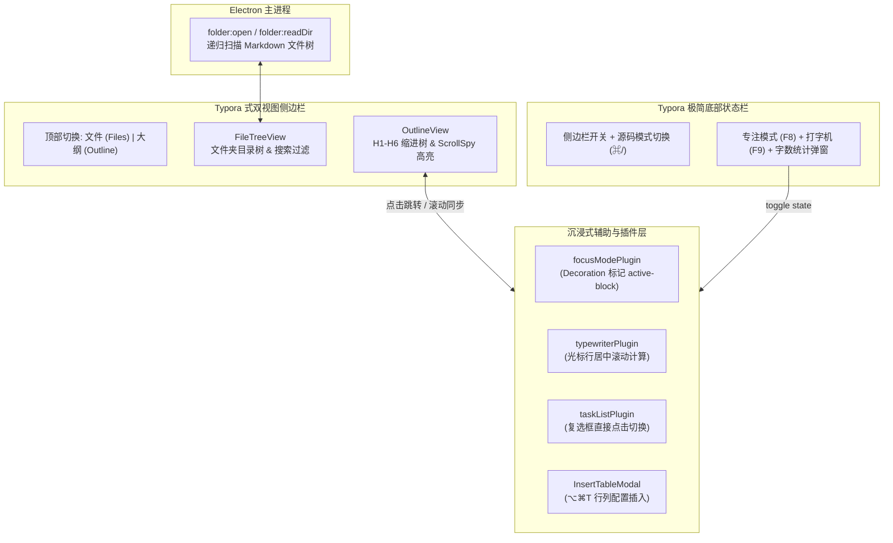

# spec-v0.2.0-m3: 对标 Typora 侧边栏双视图、沉浸式写作模式与全能力闭环

## 1. 里程碑目标与覆盖 F/AC

### 1.1 里程碑目标
全面对齐 Typora 的界面布局、核心交互与写作辅助工具体系，完成 M3 与 M4 全量能力闭环：
1. **侧边栏双视图（Sidebar：文件树 `Files` + 大纲 `Outline`）**：支持 `⇧⌘L` 与左下角状态栏按钮一键开关；顶部切换「文件 / 大纲」；文件视图扫描当前工作目录 `.md` 文件树并支持单击打开；大纲视图支持点击标题平滑滚动跳转，以及正文滚动时自动高亮当前所在章节（Scroll Spy）；
2. **专注模式（Focus Mode，`F8`）与打字机模式（Typewriter Mode，`F9`）**：专注模式下仅当前光标所在顶层块保持 100% 不透明度，其余块自动柔化退后；打字机模式下伴随输入自动保持光标所在行位于视口垂直中心；
3. **Typora 式状态栏与字数统计弹窗（Word Count Popover）**：底部极简状态栏集成侧边栏开关、源码模式切换、专注/打字机模式指示、实时字数统计；点击字数弹出 상세卡片（预计阅读时间、中英文词数、字符数、行数）；
4. **快捷插入表格弹窗（`⌥⌘T`）与交互式任务列表（Task List Checkbox）**：支持行列数可视化配置并一键插入 GFM 表格；支持在实时渲染模式下直接点击任务列表复选框切换完成状态并同步 Markdown；
5. **双模式查找与替换（`⌘F` / `⌘H`）与性能基线（F17, F18）**：在所见即所得与源码模式下均能实时查找计数、上下跳转、单个替换与全部替换；5 万字长文档打开与输入响应全面达标。

### 1.2 覆盖的 F / AC 清单
- **F15: 侧边栏（文件树 + 大纲）**
  - `AC-15.1`: `⇧⌘L` 或左下角状态栏按钮切换侧边栏显示 / 隐藏。
  - `AC-15.2`: 文件视图列出当前打开文件夹（或当前文档所在目录）下全部 `.md` 文件（含子目录），单击后在标签页打开。
  - `AC-15.3`: 大纲点击某标题后，正文对应标题平滑滚动至视口内且光标聚焦该标题。
  - `AC-15.4`: 滚动正文时，大纲中当前章节高亮随之自动更新。
- **F16: 专注模式、打字机模式、字数统计**
  - `AC-16.1`: 专注模式开启后，非当前块 `opacity < 1`（`0.25`），当前光标所在块 `opacity = 1`。
  - `AC-16.2`: 打字机模式开启后，连续输入或移动光标时自动调整滚动容器使当前行靠近视口中心。
  - `AC-16.3`: 字数统计支持中英文混排词数、字符数、行数与预计阅读时长计算，点击状态栏字数弹出详细统计卡片。
- **F11 / F9 增强: 插入表格弹窗与任务列表点击**
  - `AC-11.5`: 按 `⌥⌘T` 或点击工具栏插入表格按钮，弹出行列输入浮层并向编辑器插入指定行列数的 GFM 表格。
  - `AC-9.5`: 任务列表 `- [ ]` 渲染可交互复选框，点击复选框直接切换完成状态并更新底层 Markdown。
- **F17 / F18: 双模式查找替换与性能基线**
  - `AC-17.2`: 查找与替换在实时渲染模式和源码模式下均能正确计数、定位并替换文档内容。
  - `AC-18.1`: 5 万字文档加载与渲染耗时 ≤ 1.5s。

---

## 2. 总体架构与数据流



---

## 3. 核心接口与数据结构

### 3.1 文件夹与文件树节点定义 (`src/types/index.ts`)
```typescript
export interface FileTreeNode {
  name: string;
  path: string;
  isDirectory: boolean;
  children?: FileTreeNode[];
}
```

### 3.2 增强字数统计接口 (`src/renderer/utils/counter.ts`)
```typescript
export interface DocumentStats {
  words: number;         // 中文字符数 + 英文单词数
  characters: number;    // 总字符数（含空格）
  charactersNoSpaces: number; // 不含空格字符数
  lines: number;         // 总行数
  readingTimeMinutes: number; // 预计阅读分钟数 (按 300 词/分钟向上取整)
}
```

---

## 4. 任务拆解 (Tasks)

- **T301**: 主进程实现文件夹选择与目录树扫描 IPC（`folder:open`、`folder:readDir`），并在 `preload` 暴露安全接口。
- **T302**: 升级 `counter.ts` 字数统计引擎（支持词数、不含空格字符数、行数、阅读时间）与 `WordCountPopover` 悬浮卡片组件。
- **T303**: 实现 `Sidebar` 双视图组件（整合 `Files` 文件树与 `Outline` 大纲视图，支持 `⇧⌘L` 快捷键、大纲点击跳转与正文滚动联动高亮）。
- **T304**: 实现专注模式（`focusModePlugin`）与打字机模式（`typewriterPlugin`），绑定 `F8` / `F9` 快捷键与状态栏开关。
- **T305**: 实现任务列表复选框直接点击切换（`taskListPlugin`）与 `InsertTableModal`（`⌥⌘T` 快捷插入表格弹窗）及顶部快捷格式插入栏。
- **T306**: 完善双模式查找替换（实时渲染模式下替换实时同步至 Milkdown 视图）与 5 万字长文档性能基准测试、全量 E2E 验收。
